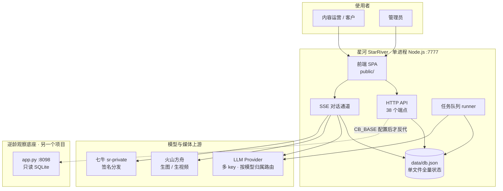
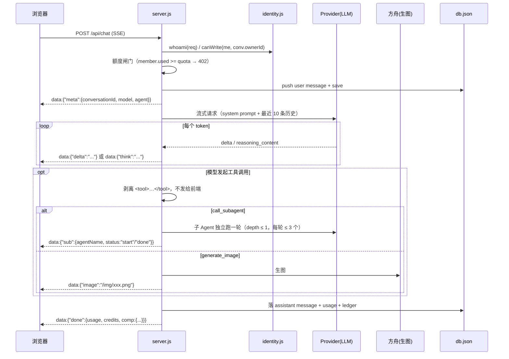
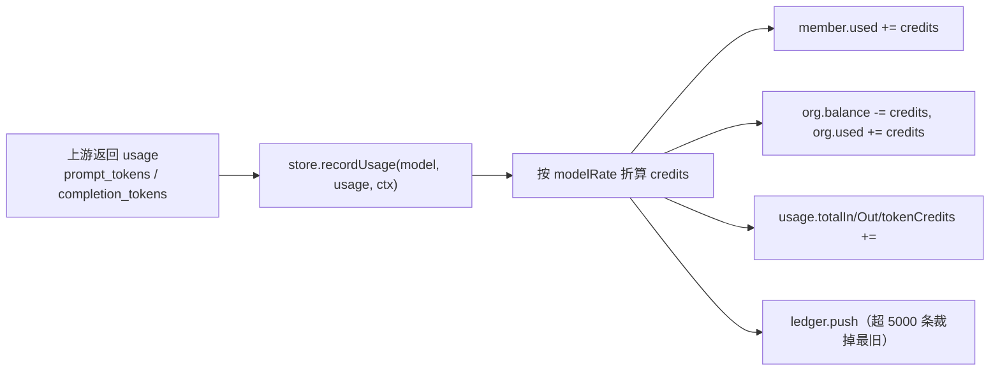

# 星河 StarRiver · 技术架构

> **这份文档的位置**：它是「一次能读完整系统」的总纲 —— 从进程边界到模块职责，从一次对话的字节流到一笔计费的落点。
>
> 专题细节不在这里重复，按需跳转：
> [配置全字段](docs/02-configuration.md) · [接口全表](docs/03-api.md) · [数据模型](docs/04-data-model.md) ·
> [计费](docs/05-billing.md) · [安全](docs/06-security.md) · [部署](docs/07-deployment.md) ·
> [运维](docs/08-operations.md) · [测试](docs/09-testing.md) · [前端](docs/10-frontend.md) ·
> [设计取舍](docs/11-tradeoffs.md)
>
> 代码基线：`server.js` 2063 行 · `store.js` 416 行 · `lib/` 8 个模块 · 前端 `app.js` 2123 行。
> 数字取自 2026-10-29 的 `main` 分支，随代码变动会漂移，看架构不用管它，看容量再核对。

---

## 目录

- [1. 定位与边界](#1-定位与边界)
- [2. 系统上下文](#2-系统上下文)
- [3. 进程与运行时](#3-进程与运行时)
- [4. 模块划分](#4-模块划分)
- [5. 关键链路](#5-关键链路)
- [6. 存储层](#6-存储层)
- [7. 计费](#7-计费)
- [8. 鉴权与隔离](#8-鉴权与隔离)
- [9. 技术选型与取舍](#9-技术选型与取舍)
- [10. 容量与实测](#10-容量与实测)
- [11. 失败模式与降级](#11-失败模式与降级)
- [12. 扩展点](#12-扩展点)
- [13. 技术债](#13-技术债)

---

## 1. 定位与边界

**一句话**：把「写选题 → 派给对的 Agent → 跑出成稿/图/视频 → 归档复用」做成一个能在自己机器上跑的内容中台，不依赖任何 SaaS，数据全在自己手里。

### 做什么

| 能力 | 落到哪个模块 |
|---|---|
| 多 Agent 协作（主 Agent 派活给子 Agent） | `server.js` 子智能体编排 |
| 流式对话（含思维链、工具调用、子 Agent 进度） | `server.js` SSE 通道 |
| 图文视频生成 | `server.js` 火山方舟适配 + `lib/ref-media.js` |
| 选题库 → 任务队列 → 自动产出 | `server.js` runner + `store.js` |
| 组织 / 成员 / 额度 / 台账 | `store.js` + `lib/identity.js` |
| 违禁词体检 | `lib/compliance.js` + `lib/compliance-dict.json` |
| Word 导出 | `lib/docx.js` |
| 私有素材签名分发 | `lib/sr-cdn.js` |

### 明确不做

| 不做 | 原因 |
|---|---|
| 不做多租户 SaaS | 单组织单实例，`org` 就是一个对象。多租户要改半边数据模型，且会引入租户隔离风险 |
| 不做分布式部署 | 状态在进程内存（`sessions` Map）+ 单 JSON 文件，天然只能单实例 |
| 不接数据库 | 见 [9.1](#91-为什么不用数据库) |
| 不做前端构建 | 原生 JS，`public/` 直接就是产物，改一行刷新即见 |
| 不自建模型 | 只做上游多 key 路由，模型能力由 provider 决定 |

---

## 2. 系统上下文



**这条虚线是关键**：底座是另一个仓库、另一个进程。星河**可以完全不配它**（`CB_BASE` 为空时就完全不改路由行为），配了才把 `/niling/`、`/api/cb/*`、`/api/wb/*` 反代过去。删掉底座，星河只剩 AI 工场功能，其余照常。

---

## 3. 进程与运行时

### 3.1 单进程

```
node server.js          →  HTTP :7777（可配）
                          ├── /api/*        38 个 JSON 端点
                          ├── /api/chat     SSE 长连接
                          ├── /            静态文件（public/）
                          └── /niling/ 等    条件反代到底座
```

进程内有两类"活"的状态，**重启即重置**：

| 状态 | 载体 | 生命周期 | 重启影响 |
|---|---|---|---|
| 登录会话 | 进程内 `sessions` Map | 7 天 TTL（`SESSION_TTL`） | 所有人需重新登录（会话也落盘到 `sessions.json`，重启会重新载入未过期部分） |
| 登录失败计数 | 进程内 `fails` Map | 5 分钟窗口 | 锁定计数清零，无实质影响 |
| 任务队列 | `db.json` 的 `tasks` | 持久 | 重启后 runner 继续捞 `queued` 的任务 ✓ |
| 其余全部业务数据 | `db.json` | 持久 | — |

> 注意会话是**落盘 + 内存双份**：启动时把 `sessions.json` 里未过期的重新装进 Map。所以重启不会踢人，只是 Map 重建。

### 3.2 零运行时依赖

`package.json` 里没有任何 `dependencies`。路由、静态服务、body 解析、cookie、SSE、multipart 解析全部手写，用 `node:http` / `node:crypto` / `node:fs`。

代价：`server.js` 2063 行里约 400 行是这些基础设施。
收益：`git clone && node server.js` 就能跑，没有 `npm install` 这一步，内网 registry 不通也不影响。

### 3.3 文件布局

```
server.js              路由 + SSE + 编排 + 方舟适配 + 静态服务（单入口）
store.js               JSON 存储层：载入 / 迁移 / 原子写 / 计费记账
lib/
  identity.js          身份与权限的唯一实现处（三档角色 + canRead/canWrite）
  compliance.js        违禁词扫描与分级
  compliance-dict.json 239 条清单词 + 35 条绝对化用语
  docx.js              零依赖 .docx 生成
  ref-media.js         参考图落盘与挂载
  sr-cdn.js            七牛私有空间签名
  text-extract.js      附件文本抽取
  chat-tools.js        工具定义与协议
public/
  index.html           工作台 SPA
  home.html            对外介绍页（未登录时的 /）
  app.js               2123 行前端逻辑
  md.js                Markdown 渲染
  style.css            4 套主题
data/                  db.json / sessions.json / uploads / 生成物（不进仓库）
```

---

## 4. 模块划分

### 4.1 `server.js` 内部分区

代码里用 `// ---------- xxx ----------` 分块，顺序就是数据流顺序：

| 行区间 | 分区 | 职责 |
|---|---|---|
| 1–67 | 常量与配置载入 | 端口、TTL、限制值、`config.json` |
| 68–207 | helpers | `json()` / `readBody()` / cookie / 失败锁定 |
| 208–294 | 多 key 路由 | `providerFor(model)` 按模型归属选 provider |
| 295–348 | 任务队列 runner | 串行消费 `queued` 任务，产出成稿 + 资产 |
| 349–398 | SSE 对话 | `pumpStream()`：上游流式 → 剥工具标签 → 推给前端 |
| 399–440 | 附件读取 | 长附件只给摘要，靠 `read_file` 按需取 |
| 441–742 | 子智能体编排 | `runSubAgent()`：独立上下文跑一轮，产出回填主 Agent |
| 743–863 | 方舟生图 | `handleImage()` |
| 864–983 | 方舟生视频 | `handleVideoCreate()` + 轮询 |
| 984–1850 | 路由 | 38 个端点（见 [docs/03-api.md](docs/03-api.md)） |
| 1851–1967 | 静态文件 | MIME、目录落 index.html、SPA fallback、`/wb/` 未安装时 404 |
| 1968–2063 | 底座反代 | 条件启用，`CB_API_PATHS` 白名单 |

### 4.2 职责边界的两条铁律

**① 权限只写一处**。业务代码里**不允许**出现 `role === 'admin'` 这类判断，一律调 `identity.isAdmin() / canRead() / canWrite()`。原因很直接：角色一多，散落各处的判断必然漏改某一处，而漏的那一处就是越权入口。

**② 写库只走 `store`**。`db.json` 只能在 `store.save()` 里写，且必须原子：先写 `.tmp` 再 `rename`。

```js
// store.js:74
save() {
  const tmp = this.file + '.tmp';
  fs.writeFileSync(tmp, JSON.stringify(this.data));
  fs.renameSync(tmp, this.file);   // rename 在同一文件系统上是原子的
}
```

半写状态（进程在 `writeFileSync` 中途被杀）不会污染原文件 —— 最坏情况是 `.tmp` 残留，下次启动被忽略。

### 4.3 `lib/` 的边界

`lib/` 里的模块**都不认识 HTTP**，只接受普通参数、返回普通值。这样它们能被 `scripts/*.mjs` 的测试脚本直接 require，不必起服务。

唯一的例外是 `sr-cdn.js`，它要读磁盘上的签名配置并对外提供 `urlFor(key)`，但仍然不碰 req/res。

---

## 5. 关键链路

### 5.1 一次对话（最核心的一条）



**SSE 帧类型**（每帧都是 `data: <json>\n\n`）：

| 帧 | 何时发 | 前端怎么用 |
|---|---|---|
| `meta` | 连接建立后第一帧 | 拿到 conversationId、模型名、Agent 名 |
| `delta` | 正文增量 | 追加渲染 |
| `think` | 思维链增量（模型支持时） | 折叠区渲染 |
| `sub` | 子 Agent 开始/结束 | 进度卡片 |
| `image` / `video` | 生图/生视频完成 | 插入消息流 |
| `done` | 结束 | 带 `usage`、`credits`、违禁词体检摘要 |

> `done` 帧里**带违禁词体检结果**，这样"写完当场知道哪里不能发"不需要第二次请求。

### 5.2 子智能体派活

```
主 Agent 输出 <tool>{"name":"call_subagent","task":"..."}</tool>
   ↓
findSubAgent(name, parent)     精确名 → 包含匹配 → 同 Box 优先
   ↓
子 Agent 用自己的 instruction + 知识库独立跑一轮（不继承主 Agent 上下文）
   ↓
产出回填主 Agent 上下文，主 Agent 继续
```

**硬限制**（`config.json`）：`subAgentDepth = 1`（子 Agent 不能再派子 Agent，否则递归失控）、`subAgentLimit = 3`（一轮最多 3 个，防止一次对话炸出 20 个并行请求）。

子 Agent 的消耗**单独记账**（`kind: 'subagent'`），不计入主 Agent 那一笔，否则对账时看不出钱花在哪。

### 5.3 任务队列自动化

```
选题库 → POST /api/tasks（queued） → runner 串行消费 → 产出成稿 + 资产 → done
```

设计要点：

- **串行**。`runnerBusy` 是个布尔锁，同一时刻只跑一个任务。理由是上游 provider 有并发限制，且串行让失败点唯一可定位。
- **记账到点任务的人**。`task.memberId` 记在发起人头上，而不是 owner —— 早先一律记 owner，导致成员额度形同虚设。
- **失败即终止该任务**，写 `status: 'error'` + 截断到 500 字的错误原因，不重试（重试会重复扣费）。

### 5.4 生图 / 生视频

| | 生图 | 生视频 |
|---|---|---|
| 上游 | 火山方舟 `doubao-seedream` 系列 | 火山方舟视频模型 |
| 参考图 | `lib/ref-media.js` 落盘，最多 9 张 | 首帧/尾帧 |
| 同步性 | 同步返回 URL | **异步任务**：创建 → 轮询状态 → 拿 URL |
| 产物 | `public/images/generated-*` | `public/videos/*.mp4` |
| 计费 | 按次 | 按次（轮询不额外计费） |

### 5.5 违禁词体检

```
文本 → 归一化（去空格/零宽/间隔点/全角转半角）
     → 扫 239 条清单词 + 35 条绝对化用语
     → 位置回填原文（保留用户原始写法，不改写）
     → 长词优先（"国家级认证"命中时不再报"国家级"）
     → 分级：block / warn / pass
```

误报豁免是有意为之：**科普 / 科学 / 科技** 里的"科"不算，"第一步"不算绝对化。

出口两个：`POST /api/compliance/check`（单独查）、`/api/chat` 的 `done` 帧（顺手查）。前端只填输入框、**不自动发送** —— 修不修由人决定。

---

## 6. 存储层

### 6.1 只有一个文件

`data/db.json`，全量状态。启动时一次性读进内存，之后所有读都是内存操作，写是"改内存 + 整体落盘"。

```json
{
  "org":         { "name", "opening", "recharged", "balance", "used", "createdAt" },
  "users":       [ { "id", "username", "name", "role", "memberId", "salt", "passHash", "status" } ],
  "members":     [ { "id", "name", "role", "quota", "used", "active" } ],
  "boxes":       [ { "id", "name", "desc" } ],
  "agents":      [ { "id", "name", "instruction", "model", "temperature", "topP",
                     "boxId", "knowledgeBases", "autoflowInstruction" } ],
  "topics":      [ { "id", "title", "content", "dimension", "used" } ],
  "conversations":[ { "id", "agentId", "title", "ownerId", "messages", "updatedAt" } ],
  "tasks":       [ { "id", "agentId", "topicId", "status", "memberId", "assetId", "error" } ],
  "assets":      [ { "id", "type", "title", "content", "agentId", "conversationId" } ],
  "uploads":     [ { "id", "name", "chars", "ownerId", "path" } ],
  "ledger":      [ { "kind", "model", "in", "out", "credits", "memberId", "at" } ],
  "usage":       { "calls", "totalIn", "totalOut", "tokenCredits", "perModel", "perDay" }
}
```

### 6.2 三条数据约束

**① 兼容式迁移**。`store.js` 构造时逐字段检查、缺什么补什么，**不重写已有数据**。所以老 `db.json` 能直接被新版本读起来，不需要写迁移脚本。

**② 台账只留最近 5000 条**（`ledger` 会裁剪），所以对账**不能**靠对台账求和。真正对账的锚点是 `usage.tokenCredits` —— 一个单调递增的累计数，首次启动从现有台账回填。

**③ 只统计 token 类**。`TOKEN_KINDS = ['chat', 'subagent', 'automate']`。`adjust` / `backfill` 是人工按积分补记的历史条目，没有对应 token 数，混进来会让"应扣 vs 已扣"凭空差几千分。

### 6.3 为什么不用数据库

| 维度 | JSON 单文件 | SQLite |
|---|---|---|
| 部署 | 复制目录即可 | 要装 sqlite3 或捆绑二进制 |
| 备份 | `cp db.json` | 要 `.backup` 或停服务 |
| 迁移 | 缺字段补上即可 | 要 ALTER TABLE + 版本管理 |
| 并发写 | **差**（全量重写） | 好 |
| 数据量上限 | **约几百 MB 后明显变慢** | TB 级 |

结论：在**单组织、几十人、几万条会话**这个量级，JSON 的简单性收益 > 并发劣势。越过这个量级就该换 —— 这是明确的已知边界，不是"以后再说"。

---

## 7. 计费

### 7.1 一笔消耗的完整路径



### 7.2 三道闸

| 闸 | 位置 | 触发结果 |
|---|---|---|
| 成员额度 | `/api/chat` 入口 | `402`，带 `used/quota`，提示找管理员加额度 |
| 组织余额 | 充值/扣减 | 余额不足时管理员操作被拒 |
| 上游失败 | 请求发出后 | **不扣费** —— 只有拿到 `usage` 才记账 |

### 7.3 计费口径

`credits = (in_tokens × inRate + out_tokens × outRate)`，单位是"积分"。`billing.defaultRate` 是兜底费率，`billing.modelRates` 按模型覆盖。

**为什么按 token 而不是按次**：按次在"同一句话让模型写 300 字 vs 3000 字"之间无法定价，而这两种才是真实使用差异。

---

## 8. 鉴权与隔离

### 8.1 三档角色

| 角色 | 值 | 能做什么 |
|---|---|---|
| `owner` | 3 | 全部；**唯一能授予/撤销 admin** |
| `admin` | 2 | 管理区、改 Agent/Box、看全组织数据、管账号 |
| `member` | 1 | 只能碰自己的会话/资产/上传 |

设计意图：owner 和 admin 分开，是为防"管理员互相提权" —— 如果 admin 能提 admin，一个人被攻破就等于整个组织被接管。

### 8.2 隔离规则（服务端强制）

| 数据 | 读取 | 写入 |
|---|---|---|
| 会话 | 管理员全看；成员只看 `ownerId === self` | 同上 |
| 资产 / 上传 | 同上 | 同上 |
| 无主数据（老数据没 ownerId） | **只有 owner 能看** | 只有 owner |

最后一条是迁移期兜底：如果"无主"等于"人人可见"，那就是一个默认公开的漏洞。

### 8.3 登录防护

- 密码 `scrypt` 加盐，`timingSafeEqual` 比对（防计时侧信道）
- 账号不存在与密码错误**走同一条路径、同一句提示、同样计一次失败** —— 不给枚举账号的机会
- 5 次失败锁 5 分钟（`FAIL_MAX` / `FAIL_WINDOW`）
- Cookie：`HttpOnly` + `SameSite=Lax`，7 天 TTL

---

## 9. 技术选型与取舍

### 9.1 为什么不用数据库

见 [6.3](#63-为什么不用数据库)。一句话：数据量和并发都在"单文件够用"的区间内，而简单性带来的部署/备份/迁移收益是立刻兑现的。

**这条的代价必须记住**：`save()` 是**全量重写**。`db.json` 长到 100MB 时，每次保存都写 100MB，一次对话可能触发多次保存。那时要么换库，要么把热数据拆出去。

### 9.2 为什么零依赖

| 理由 | 说明 |
|---|---|
| 部署环境在内网 | `npm install` 常因 registry 不可达失败 |
| 依赖会腐 | 半年后 `npm i` 装出来的东西和当时已经不一样 |
| 攻击面 | 一个 200 行中间件链，实际用到的不到 10 行 |

### 9.3 为什么 SSE 而不是 WebSocket

单向流式（服务端 → 浏览器）用 SSE 就够，且 SSE 天然是 HTTP，不需要 `Upgrade` 握手、不需要单独的心跳和重连协议、nginx 前面只多一个 `X-Accel-Buffering: no` 头。

代价：不能双工。但对话场景用户的操作是"发一条 → 看它流式输出"，不需要中途推送。

### 9.4 为什么前端不构建

`public/` 直接就是运行产物。改一行 CSS 刷新即见，没有 `npm run build` 这一步，也就没有"忘了构建所以看到旧版"这类问题 —— 这个坑在别处踩过一次，部署时前端没推上去，接口是新的、页面是旧的，功能对用户等于不存在。

### 9.5 为什么长文要强制"一次一篇"

单次回复有硬上限（约 8000 token），写到一半会被直接切断，用户拿到残稿且平台不会自动重来。所以 `buildSystemPrompt()` 里加了平台级硬约束：要 N 篇就**先排队列（标题 + 角度）、再写第 1 篇、末尾提示"回复继续写第 2 篇"**。

这条约束写在代码里而不是文档里，因为它必须**对每个 Agent 生效**，不能靠人记得在提示词里加。

---

## 10. 容量与实测

| 指标 | 实测值 | 测量方式 |
|---|---|---|
| 启动到可服务 | < 1s | `node server.js` 到 `/api/ping` 返回 |
| 空载内存 | 约 60–90 MB | 单进程，随 `db.json` 大小增长 |
| `db.json` 典型大小 | 数 MB ~ 数十 MB | 取决于会话数与资产正文 |
| SSE 首帧延迟 | 等于上游首 token 延迟 | 本地无额外缓冲 |
| 静态文件 | 直接 `readFileSync`，无缓存层 | 每次请求读盘（换取"改完即生效"） |

**没有做过的压测**：并发 SSE 连接数、大规模 `db.json` 下的保存耗时。这两项是空白，不编数字。

---

## 11. 失败模式与降级

| 失败 | 表现 | 系统行为 | 用户看到 |
|---|---|---|---|
| 上游 4xx/5xx | provider 返回错误 | 不扣费，`done` 帧带错误 | 气泡里红字，可重试 |
| 上游超时/断流 | 流中断 | 已收到的部分保留落库 | 残稿 + "继续"按钮 |
| 输出撞上限被截断 | 句子中断 | **显性报错**，不静默当成功 | 明确提示"输出被截断" |
| 上游返回非 JSON | 解析失败 | 抛错，截断错误信息 | 错误提示 |
| 子 Agent 找不到 | 名字不匹配 | 抛错并列出可用 Agent 名 | 提示"没有找到 X，可用：…" |
| 生图/生视频失败 | 方舟返回错误 | 消息流里标注失败，其余内容照常 | 图片位置显示失败原因 |
| `db.json` 损坏 | JSON.parse 抛错 | **启动即失败**（不静默重建空库） | 服务起不来 |
| 磁盘写失败 | `writeFileSync` 抛错 | 抛到调用处 | 接口 500 |
| 底座未配置 | `CB_BASE` 为空 | `/niling/` 等路径不反代，走星河自己的路由 | 星河的 404 |
| `/wb/` 未安装 | `public/wb/` 不存在 | **404 + 明确提示"工作台未安装"** | 明确知道是没装，而不是看到星河首页 |

最后两条是同一个教训：**200 + 正常页面是最难排查的假成功**。看着像成功，实际是另一个站。

---

## 12. 扩展点

### 加一个 Agent

往 `db.json` 的 `agents` 里加一条，或在控制台 `POST /api/agents`。字段：`name` / `instruction` / `model` / `boxId` / `knowledgeBases`。

注意 `instruction` 会与平台级硬约束**拼接**（`buildSystemPrompt()`），后者优先。所以不要在自定义提示词里写"一次输出 5 篇" —— 它会被平台约束覆盖。

### 加一个模型 provider

`config.json` 的 `providers` 数组加一项：`{ id, label, apiKey, models: [...] }`。`providerFor(model)` 按 `models` 反查归属，第一项是兜底。

### 加一个工具

1. `lib/chat-tools.js` 里定义 schema
2. `server.js` SSE 链路里加分支处理
3. 在 `done` 帧或 `sub` 帧里回传结果

工具调用走 `<tool>{json}</tool>` 文本协议（不是 OpenAI function calling），因为要兼容的上游不止一家，功能的交集只有纯文本。

### 加一个底座 API 反代

`CB_API_PATHS` 这个 `Set` 里加一条路径。不加就在这里 —— 白名单而非黑名单，是为了避免"星河的某个 `/api/xxx` 被顺手代理到底座"这种意外。

---

## 13. 技术债

诚实列，不美化。

| 债 | 现状 | 后果 | 什么时候必须还 |
|---|---|---|---|
| `db.json` 全量重写 | 每次 save 写整个文件 | 文件越大越慢；并发写无保护 | `db.json` > 100MB 或出现保存超时 |
| 单实例 | 会话在内存、文件在本地 | 不能水平扩展 | 用户数超出单机承载 |
| `server.js` 2063 行 | 单文件包含路由 + SSE + 编排 + 方舟 + 静态 | 改一处要读很大范围；合并冲突概率高 | 继续增长就该拆 `routes/` `handlers/` |
| 工具协议是文本约定 | `<tool>` 标签解析 | 模型输出不合格式就失效，容错靠正则 | 上游普遍支持 function calling 后可换 |
| 上游无重试 | 失败即终止 | 偶发 5xx 直接失败给用户 | 想提高成功率时加**幂等**重试（要配合计费去重） |
| 无压测 | 无并发数据 | 不知道拐点在哪 | 上线给更多人前 |
| 静态文件每次读盘 | 换取"改完即生效" | 高并发下 IO 放大 | 静态资源变大或 QPS 上来 |
| 前端 2123 行单文件 | `app.js` 一体 | 同上 | 功能继续加就该拆模块 |

---

## 附：和另外两个项目的关系

星河是**独立项目、独立仓库**，不依赖谁也能单独跑。

| 产品 | 在哪个仓库 | 和数据的关系 |
|---|---|---|
| **星河 StarRiver** | 本仓库 | 自己一套业务库 `data/db.json` |
| **六品牌内容工作台** | `cosmo-platform` 的 `workbench/` | 只读共用底座数据 |
| **逆龄观察** | `cosmo-platform` 的 `app.py` | 只读共用底座数据 |

后两个是同一个项目（一套数据、两个视角，前端面向的人不同）。生产上由本网关反代 `/niling/` 和 `/api/cb/*`，工作台静态文件放在 `public/wb/` —— 这是**部署时的组合**，不是代码依赖。
