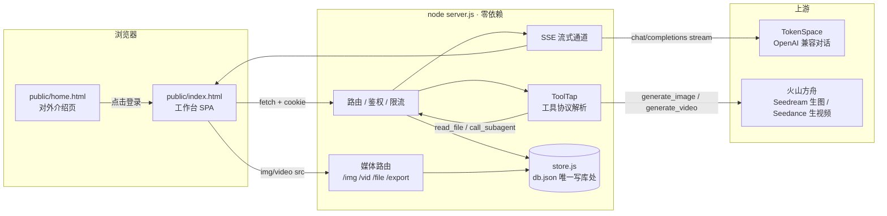

# 春科 · 星河 StarRiver

**全域营销内容 AI 工场** —— 一支不会请假的内容团队：专职 AI 员工接需求，任务队列自动跑，成稿、成图、成片直接进数字资产库。

<p>


</p>

> 一句话：把「写选题 → 派给对的人 → 跑出成稿 → 归档复用」这条链子做成一个能在自己机器/自己服务器上跑的中台，
> 不依赖任何 SaaS，数据全在自己手里。

---

## 目录

- [一、这是什么](#一这是什么)
- [二、功能矩阵](#二功能矩阵)
- [三、架构总览](#三架构总览)
- [四、10 分钟跑起来](#四10-分钟跑起来)
- [五、配置详解](#五配置详解)
- [六、运行方式](#六运行方式)
- [七、账号与权限](#七账号与权限)
- [八、一次对话的完整生命周期](#八一次对话的完整生命周期)
- [九、接口总览](#九接口总览)
- [十、计费与对账](#十计费与对账)
- [十一、数据与文件布局](#十一数据与文件布局)
- [十二、安全模型](#十二安全模型)
- [十三、测试](#十三测试)
- [十四、目录结构](#十四目录结构)
- [十五、部署到服务器](#十五部署到服务器)
- [十六、常见问题](#十六常见问题)
- [十七、已知限制](#十七已知限制)
- [十八、路线图](#十八路线图)
- [十九、文档索引](#十九文档索引)
- [二十、许可证](#二十许可证)

---

## 一、这是什么

### 1.1 解决的问题

内容团队的真实痛点不是"没有 AI"，而是：

| 痛点 | 表现 | 本产品的做法 |
|---|---|---|
| 提示词散落 | 每个人的提示词存在备忘录里，换人就丢 | 38 个专职 Agent 连提示词带知识库入库，版本可管 |
| 一次只能干一件 | 一个人对着一个对话框，串行 | Automate 任务队列，一次派 1144 条选题，串行跑完自动归档 |
| 产出找不到 | 生成的稿子散在聊天记录里 | 所有产物落资产库，可搜索、可收藏、可回收站 |
| 不知道花了多少钱 | 月底看账单才知道烧了多少 | 每一笔调用落台账：模型单价 × token + 媒体按张/按秒 |
| 外人一用就乱 | 同事/客户共用一把密码 | 多账号 + 数据隔离 + 额度闸门 |

### 1.2 形态

- **单进程 Node 服务**，零运行时依赖（只用 Node 标准库）。
- **数据全部落本地 JSON**（`data/db.json`），拷一个目录就是完整备份。
- **前端是单文件 SPA**（`public/app.js`，原生 JS），无框架、无构建步骤。
- **上游可换**：默认走 TokenSpace（OpenAI 兼容协议）+ 火山方舟（生图/生视频）。

### 1.3 适合谁

- 品牌方/agency 的内容团队，需要一个内部中台沉淀提示词与成品；
- 想先把 AI 内容流水线跑通、再决定要不要买 SaaS 的团队；
- 对数据出域敏感（客户名单、未公开文案不能上第三方）。

---

## 二、功能矩阵

| 模块 | 能力 | 状态 |
|---|---|---|
| **登录** | 账号密码 → 服务端会话 Cookie；失败 5 次锁 5 分钟 | ✅ |
| **Box** | 团队空间，Agent 按 Box 分组；删 Box 时 Agent 自动回落 | ✅ |
| **Agent** | 38 个专职 Agent（提示词 50.8 万字）、分类、搜索、快捷指令 140 条 | ✅ |
| **Agent** | 知识库挂载（多份，可上传 pdf/docx/txt/md/csv 自动抽正文） | ✅ |
| **Agent** | 启用 / 挂起（挂起后 @ 弹窗灰显、发送前后端双拦 409） | ✅ |
| **对话** | 流式输出 + Markdown 实时成型（标题/列表/表格/代码块/引用） | ✅ |
| **对话** | 思维链独立通道（不污染正文）、工具过程卡（出图/出片/读文件/派活） | ✅ |
| **对话** | `@` 就地换 Agent（保留上下文）；子智能体编排（`call_subagent`） | ✅ |
| **对话** | 附件上传（≤5 个，9 种格式）；长附件按需读（`read_file`） | ✅ |
| **对话** | 参考图（≤9 张，资产图 + 上传图混排） | ✅ |
| **生成** | 生图（方舟 Seedream，7 个型号，5 种比例） | ✅ |
| **生成** | 生视频（Seedance 4 型号，参数自动落回合法档位） | ✅ |
| **合规** | 违禁词体检：239 条客户清单 + 35 条绝对化用语，写完自动扫，标位置给替换建议 | ✅ |
| **Automate** | 1144 条选题、56 维度筛选、批量派活、串行队列、失败可重跑 | ✅ |
| **资产** | 图片/视频/文档统一入库；收藏、回收站、恢复、彻底删除 | ✅ |
| **资产** | 导出 docx / 下载 md / 复制正文 / 以图为参考继续生成 | ✅ |
| **资产** | **团队可见**共享开关（默认私有，共享后同事只读） | ✅ |
| **台账** | 每笔调用记账：模型单价 × token、图片按张、视频按秒 | ✅ |
| **台账** | 按天/类型/模型/成员/Box 五维汇总、CSV 导出、账本自洽对账 | ✅ |
| **组织** | 余额充值/调账、成员额度与进度、低额度告警 | ✅ |
| **账号** | 三角色、建号/停用/重置密码/改额度、邀请码注册 | ✅ |
| **检索** | 全局搜索（会话内容 + 资产） | ✅ |
| **体验环境** | 独立库 + 独立端口 + 独立账号 + 额度上限，一键起 | ✅ |
| **介绍页** | 站点根 `/` 对外介绍，已登录自动跳工作台 | ✅ |

---

## 三、架构总览

### 3.1 一张图



### 3.2 三层职责

```text
┌──────────────────────────────────────────────────────────┐
│  transport   server.js                                   │
│  HTTP 路由、Cookie 鉴权、SSE 帧、上游调用、媒体服务        │
├──────────────────────────────────────────────────────────┤
│  domain      store.js + lib/identity.js + lib/text-extract│
│  数据结构与迁移、记账与对账、权限判定、附件抽文            │
├──────────────────────────────────────────────────────────┤
│  view        public/app.js + md.js + style.css           │
│  视图函数、路由 hash、Markdown 渲染、主题令牌              │
└──────────────────────────────────────────────────────────┘
```

**为什么这么切**：

- 权限判断只有一处（`lib/identity.js`），新增数据表不会漏改某处 `role === 'admin'`；
- 写库只有一处（`store.js`），避免业务代码里散落 `fs.writeFileSync`；
- 前端零构建，改一行刷新就生效，部署时不用 `npm run build`。

### 3.3 关键设计取舍

| 决策 | 选择 | 放弃的是什么 |
|---|---|---|
| 存储 | 单 JSON 文件 + 启动时全量载入 | 放弃并发写入能力；换来"拷目录即备份" |
| 依赖 | 运行时零依赖 | 放弃 ORM/框架的便利；换来十年后还能跑 |
| 前端 | 原生 JS 单文件 | 放弃组件化；换来改样式不用等构建 |
| 鉴权 | 自建 Cookie 会话 | 放弃 OAuth/SSO；换来零配置部署 |
| 隔离 | `ownerId` 逐条打标 | 放弃"多租户共享知识库"的便利；换来不会串号 |

---

## 四、10 分钟跑起来

### 4.1 前置

- Node.js **18+**（推荐 22）。检查：`node -v`
- 一个 OpenAI 兼容的上游 Key（默认 TokenSpace），生图/生视频需要火山方舟 Key（可选，不配则相关功能报错但其他功能可用）

### 4.2 三步

```bash
# 1) 克隆 + 配配置
git clone <repo-url> starbox-clone && cd starbox-clone
cp config.example.json config.json
$EDITOR config.json          # 至少要改 auth.password 和两处 apiKey

# 2) 起服务（零依赖，不用 npm install）
./start.sh                   # → http://127.0.0.1:7777

# 3) 用 config.json 里的 auth 账号登录
open http://127.0.0.1:7777
```

首次启动会发生三件事：

1. 创建 `data/` 目录与 `db.json`（空库）；
2. 把 `config.auth` 的**明文密码迁移成 scrypt 哈希**写进 `users` 表（之后 `config.auth.password` 即失效，改密码走界面或 `/api/auth/password`）；
3. 启动对账 `store.reconcile()`，确保 `余额 = 期初 + 充值 − 台账合计`。

> ⚠️ 空库没有 Agent 和选题。要导入种子数据（38 个 Agent + 1144 条选题）：
> ```bash
> node seed.js /path/to/starbox_assets
> ```

### 4.3 验证装对了

```bash
curl -s http://127.0.0.1:7777/api/ping          # {"ok":true,...}
curl -s http://127.0.0.1:7777/api/auth/state    # {"loggedIn":false,...}
node scripts/selftest.mjs                       # 23 通过 / 0 失败
```

---

## 五、配置详解

### 5.1 `config.json` 全字段

> 完整示例见 [`config.example.json`](config.example.json)。**这个文件已在 `.gitignore` 里，永远不要提交。**

| 字段 | 类型 | 说明 |
|---|---|---|
| `baseUrl` | string | 上游 OpenAI 兼容网关地址 |
| `providers[]` | array | 上游分组。每项 `{id,label,apiKey,models[]}`；不同分组可用不同 Key |
| `providers[].models[]` | string[] | 该分组下可选的模型 ID（前端模型下拉的数据源） |
| `defaultModel` | string | 新会话默认模型 |
| `maxTokens` | string | 单次生成上限（字符串形式，直接透传给上游） |
| `imageModels` | string[] | 生图可选型号 |
| `imageSize` | string | 默认出图尺寸，如 `1024x1024` |
| `auth.username` / `auth.password` | string | **仅首次启动**用于创建 owner；之后明文作废 |
| `port` | number | 监听端口，默认 7777（`PORT` 环境变量优先） |
| `kbTotalLimit` | number | 单个 Agent 知识库总字数上限 |
| `historyLimit` | number | 带入上下文的历史轮数 |
| `historyMsgCap` | number | 上下文字符硬上限 |
| `subAgentLimit` | number | 一次对话内子智能体调用次数上限 |
| `subAgentDepth` | number | 子智能体嵌套深度（目前 1） |
| `attachInlineLimit` | number | 附件内联字数阈值，超过则改走 `read_file` 按需读 |
| `billing.unit` / `billing.room` | string | 积分单位名（界面展示用） |
| `billing.balance` | number | 期初额度（首次建库时写入 `org.opening`） |
| `billing.lowBalance` | number | 低额度告警阈值 |
| `billing.defaultRate` | number | 未在 `modelRate` 里配置的模型，按此单价 |
| `billing.modelRate` | object | 单一价：`{模型ID: 每千 token 积分}` |
| `billing.modelRate2` | object | **分价（可选）**：`{模型ID:{in,out}}`，配置后优先于 `modelRate` |
| `billing.media.image` | number | 每张图积分 |
| `billing.media.videoPerSecond` | object | 每个视频模型每秒积分 |
| `members[]` | array | 期初成员（`{name,role,quota}`），首次建库时写入 |
| `ark.baseUrl` / `ark.apiKey` | string | 火山方舟网关与 Key（生图/生视频） |
| `ark.imageModel` / `ark.imageSize` | string | 默认生图型号与尺寸 |
| `ark.videoDefault` / `ark.videoToolDefault` | string | 默认视频型号（对话内工具 vs 主动生成） |
| `ark.videoModels[]` | array | 视频型号能力表：`{id,label,note,resolutions,durations,ratios,audio}` |

**分价是怎么生效的**：

```text
配了 modelRate2[m]  →  credits = in/1000 × modelRate2[m].in + out/1000 × modelRate2[m].out
没配              →  credits = (in + out)/1000 × modelRate[m]      （或 defaultRate）
```

历史账不因改配置而变动（`ledger` 里逐笔存了 `rate/rateIn/rateOut`）。

### 5.2 环境变量

| 变量 | 默认 | 作用 |
|---|---|---|
| `PORT` | `config.port` | 监听端口 |
| `SB_HOST` | `127.0.0.1` | 监听地址。`0.0.0.0` 才可被局域网/公网访问 |
| `SB_DATA` | `./data` | 数据目录。体验环境指向 `./data-demo` 实现完全隔离 |
| `SB_USER` / `SB_PASS` | `config.auth.*` | **空库首次建 owner** 时覆盖 config 里的账号（适合体验库，避免外发主密码） |
| `CB_PYTHON` | 自动探测 | 附件抽取用的 Python 解释器（pdf 抽取依赖 pypdf） |
| `SB_MAX_CONTINUE` | `2` | 撞到单次输出上限后自动续写的轮数；0 = 不续写 |
| `SB_MAX_TOKENS` | 上游默认 | 单次输出上限（排查截断时临时调小用） |
| `NODE_BIN` | 自动探测 | `start.sh` / `start-demo.sh` 用哪个 node |
| `PW_PREFIX` | — | 仅测试：Playwright 装在非标准位置时指过去 |
| `BASE` | `http://127.0.0.1:7777` | 仅测试：验收脚本打哪个服务 |

---

## 六、运行方式

### 6.1 本机（默认）

```bash
./start.sh                    # http://127.0.0.1:7777
```

### 6.2 局域网给同事看

```bash
SB_HOST=0.0.0.0 ./start.sh    # 别人访问 http://<你的内网IP>:7777
ipconfig getifaddr en0        # macOS 查内网 IP
```

### 6.3 体验环境（外人用，绝不碰正式数据）

```bash
./start-demo.sh                  # 本机 7788
LAN=1 ./start-demo.sh            # 局域网可访问
DEMO_PASS=xxx ./start-demo.sh    # 换体验账号密码
DEMO_INVITE=1 ./start-demo.sh    # 开放邀请码，让外人自己注册
./start-demo.sh --reset          # 清空外人留下的会话/资产，回到干净状态
```

体验环境与正式环境是**两套完全独立的库**：

| | 正式 | 体验 |
|---|---|---|
| 数据目录 | `data/` | `data-demo/` |
| 端口 | 7777 | 7788 |
| 账号 | 你自己 | `demo`（哈希写在库里） |
| 期初额度 | `billing.balance` | 20,000（用完 402 拦住） |
| 主密码能否登录 | 能 | **401**（实测） |

### 6.4 常驻运行

```bash
# 方式一：systemd（Linux 服务器推荐，见 docs/07-operations.md）
sudo systemctl start star-river

# 方式二：macOS launchd（本机开机自启）
launchctl load ~/Library/LaunchAgents/cn.chunke.starriver.plist

# 方式三：临时前台
node server.js
```

---

## 七、账号与权限

### 7.1 三层角色

| 角色 | 能做什么 | 不能做什么 |
|---|---|---|
| **owner 所有者** | 全部；授予/撤销 admin；停用或重置 admin | 停用自己之外没有限制 |
| **admin 管理员** | 建号/停用/重置密码/改额度/充值/调账；管 Box 与 Agent；看全组织台账 | 不能给自己升 owner、不能动 owner、不能新建 admin |
| **member 成员** | 自己的会话/资产/上传/台账；改自己的密码 | 管理类接口一律 403；看不到别人的任何东西 |

判断全部集中在 [`lib/identity.js`](lib/identity.js) 的 `canRead / canWrite / canManageUsers`。

### 7.2 隔离规则（服务端强制，不靠前端藏按钮）

| 对象 | 读 | 写/删 |
|---|---|---|
| 会话 | 自己的 + 管理员全部 | 自己的 + 管理员 |
| 资产 | 自己的 + **被共享的** + 管理员全部 | 仅自己的 + 管理员 |
| 上传附件 | 仅自己的 + 管理员 | 仅自己的 |
| 导出件 | 仅自己的 + 管理员 | 仅自己的 |
| 台账 | 自己的（`ownerId` 或 `memberId` 命中）+ 管理员全部 | 只读 |

- 越权访问一律返回 **404**，不返回 403 —— 不告诉对方"这条存在，只是不给你"。
- 消耗只能记在登录人名下；`POST /api/member/switch` 已废弃，返回 **410**。

### 7.3 注册与建号

- 默认**关闭**自助注册。管理员在「账号与权限」生成邀请码（`POST /api/org/invite`）后才可注册。
- 管理员直接建号：`POST /api/users`（返回一次性明文密码，请当面给）。
- 密码规则：≥8 位，含字母与数字；不强制符号（避免"写便利贴"）。

---

## 八、一次对话的完整生命周期

这一节是给维护者看的：出问题时能立刻定位在哪一段。

```text
① 前端 public/app.js  POST /api/chat  (SSE)
       │  带 cookie + {content, model, agentId, conversationId?, uploads[], refs[]}
       ▼
② server.js handleChat()
       ├─ auth() 取登录用户（停用即 401）
       ├─ 余额闸门：org.balance ≤ 0        → 402
       ├─ 额度闸门：member.used ≥ quota    → 402
       ├─ 闸门在建会话之前（否则会留一堆空会话，踩过）
       ▼
③ 组装上下文
       ├─ 系统提示词 = Agent 提示词 + 知识库 + TOOL_PROMPT
       ├─ 历史 = 最近 historyLimit 轮，总字符 ≤ historyMsgCap
       ├─ 附件：≤ attachInlineLimit 字内联，超过只给摘要并允许 read_file
       └─ 参考图：转 768px JPEG 后以 data URI 传给方舟
       ▼
④ pumpStream() 请求上游（stream: true）
       ├─ SSE 帧：{"meta":{conversationId, model, agent, member}}
       ├─          {"delta":"..."}   正文增量
       ├─          {"think":"..."}   思维链增量（不进正文）
       └─          {"tool":{name,status,...}}  工具过程
       ▼
⑤ ToolTap 解析上游工具调用
       ├─ generate_image  → 方舟 Seedream → 落 assets → {"tool":{name,status:'done',asset}}
       ├─ generate_video  → 方舟 Seedance → 落 assets（异步轮询）
       ├─ read_file       → 按关键词/位置取附件原文 → {"tool":{...,read:{file,chars,query}}}
       └─ call_subagent   → 子 Agent 独立跑一轮 → 折叠卡回填并进下一轮上下文
       ▼
⑥ 记账 store.recordUsage()
       ├─ token：直接取上游 usage 的 prompt_tokens / completion_tokens
       ├─ 上游没回 usage → 按字符估算并标 estimated（不让这一轮白送）
       ├─ 上游中断 → 已产生的部分补记一次（billedFirst 防重复）
       └─ 落 ledger：{ts, day, kind, model, in, out, rate, credits, ownerId, memberId, ...}
       ▼
⑦ 收尾
       ├─ 消息写回 conv.messages（含 think / tool 过程）
       ├─ store.save()（唯一落盘点）
       └─ {"done":true} 关闭 SSE
```

**排查提示**：

- 只有 `meta` 没有 `delta` → 上游连不上或 Key 失效，看服务端日志的上游状态码；
- 有 `delta` 但不落库 → 记账或 `store.save()` 抛错，查进程日志；
- 台账有数但余额没动 → `store.reconcile()` 会在下次启动纠正，先看 `ledger.over` 标记。

---

## 九、接口总览

全部接口前缀 `/api`，除 `/api/ping`、`/api/auth/*` 外都需要登录 Cookie。
完整字段说明见 [`docs/03-api.md`](docs/03-api.md)。

### 9.1 认证与账号

| 方法 | 路径 | 说明 | 权限 |
|---|---|---|---|
| POST | `/api/auth/login` | 登录，Set-Cookie `sid` | 公开 |
| POST | `/api/auth/register` | 邀请码注册 | 公开（需邀请码） |
| POST | `/api/auth/logout` | 退出 | 登录 |
| GET | `/api/auth/state` | 是否已登录（给前端探状态用，不报 401） | 公开 |
| GET | `/api/auth/me` | 当前用户 | 登录 |
| POST | `/api/auth/password` | 改自己的密码 | 登录 |
| GET | `/api/users` | 账号列表 | 管理员 |
| POST | `/api/users` | 建号（返回一次性密码） | 管理员 |
| POST | `/api/users/:id/status` | 停用/启用 | 管理员 |
| POST | `/api/users/:id/password` | 重置密码 | 管理员 |
| PATCH | `/api/users/:id` | 改额度/角色 | 管理员（角色仅 owner） |
| POST | `/api/org/invite` | 生成邀请码 | 管理员 |

### 9.2 内容生产

| 方法 | 路径 | 说明 |
|---|---|---|
| GET | `/api/bootstrap` | 首屏数据：组织、Box、Agent、成员、当前用户 |
| GET/POST/PATCH/DELETE | `/api/boxes`、`/api/box/:id` | 团队空间 |
| GET/POST/PATCH/DELETE | `/api/agents`、`/api/agent/:id` | Agent 与知识库 |
| POST | `/api/chat` | 对话（SSE 流） |
| GET/POST/PATCH/DELETE | `/api/conversations`、`/api/conversation/:id` | 会话 |
| POST | `/api/conversation/:id/agent` | @ 换 Agent（保留上下文） |
| POST | `/api/upload` / GET `/api/uploads` | 附件 |
| GET | `/api/reference-images` | 参考图库（资产图 + 上传图） |
| POST | `/api/image` / `/api/video` | 主动生图 / 生视频 |
| GET | `/api/video/:id` | 视频任务状态 |
| GET | `/api/topics` / POST `/api/tasks` | 选题与批量任务 |
| GET/POST/PATCH/DELETE | `/api/assets`、`/api/asset/:id` | 资产 |
| POST | `/api/asset/:id/share` | **团队可见开关** |
| POST | `/api/asset/:id/fav`、`/restore` | 收藏 / 恢复 |
| POST | `/api/compliance/check` | **违禁词体检**（命中词 / 位置 / 替换建议） |
| GET | `/api/compliance/dict` | 词表本体（客户清单 + 广告法绝对化用语） |

### 9.3 计费与组织

| 方法 | 路径 | 说明 |
|---|---|---|
| GET | `/api/ledger` | 台账（成员只看自己） |
| GET | `/api/ledger.csv` | 导出台账 |
| GET | `/api/org` / PATCH `/api/org` | 组织信息与改名 |
| POST | `/api/org/recharge` | 充值（记账，不直接改余额） |
| POST | `/api/org/adjust` | 调账（正数加、负数减） |
| GET | `/api/billing/audit` | 对账：应扣 / 已扣 / 补记 / 差额 |
| GET/POST/PATCH/DELETE | `/api/members`、`/api/member/:id` | 成员 |
| POST | `/api/docx` | 导出 docx |

### 9.4 SSE 帧格式

```text
data: {"meta":{"conversationId":"c-1","model":"claude-sonnet-4-6","agent":{"id":"a-1","name":"…"},"member":"秋峰"}}
data: {"think":"先看受众是…"}
data: {"tool":{"name":"generate_image","status":"start","prompt":"…","label":"正在出图"}}
data: {"tool":{"name":"generate_image","status":"done","asset":{"id":"as-1","type":"image","url":"/img/xxx.png"}}}
data: {"delta":"## 标题\n\n正文…"}
data: {"done":true}
```

错误帧：`data: {"error":"上游 429，请稍后重试"}`。

---

## 十、计费与对账

### 10.1 唯一真相源

```text
余额 = org.opening（期初） + org.recharged（累计充值） − Σ ledger.credits
```

任何地方都不允许直接改 `balance`。改余额只有两条路：`/api/org/recharge`（充值）、`/api/org/adjust`（调账），都会落一条台账。`store.reconcile()` 在每次启动时重算一遍，手改库会被自动纠正。

### 10.2 计价口径

| 类型 | 公式 |
|---|---|
| 对话（单一价） | `(in + out) / 1000 × modelRate[model]` |
| 对话（分价） | `in/1000 × rateIn + out/1000 × rateOut` |
| 图片 | `media.image` × 张数 |
| 视频 | `media.videoPerSecond[model]` × 秒数 |
| 子智能体 | 单独归类 `kind: 'subagent'`，同样按 token 计 |

### 10.3 对账三件事

| 检查 | 命令 | 看什么 |
|---|---|---|
| 库内自洽 | `GET /api/billing/audit` | 应扣 vs 已扣，差额应 < 1 积分 |
| 与上游一致 | `node scripts/audit-credit-upstream.mjs` | 本地 token 数与上游 `usage` 累计是否一致 |
| 单价标定 | `node scripts/calibrate-upstream-price.mjs` | 反解上游真实单价，校验我们的 rate 是否偏离 |

**已知口径差异**：本地"单一价"与上游"输入/输出 5 倍差价"不同构。当前输出占比低（约 0.4%），所以总额没跑偏；但输出占比高的模型（如 haiku 约 15%）在单一价下会亏损。改分价的方案见 [`docs/05-billing.md`](docs/05-billing.md)。

---

## 十一、数据与文件布局

```text
data/                      ← 已在 .gitignore，绝不要提交
├── db.json                # 唯一数据库（会话/资产/台账/用户/组织…）
├── sessions.json          # 登录态（7 天 TTL）
├── images/                # 生成的图片（/img/ 路由从这里读）
├── videos/                # 生成的视频（/vid/）
├── uploads/               # 用户上传的附件（/file/）
└── exports/               # 导出的 docx（/export/）

data-demo/                 ← 体验环境，结构同上，完全独立
```

`db.json` 顶层集合：

| 集合 | 含义 | 关键字段 |
|---|---|---|
| `boxes` | 团队空间 | `id,name` |
| `agents` | 专职 AI 员工 | `id,name,category,model,instruction,knowledgeBases,boxId,suspended` |
| `topics` | 选题库 | `title,dims` |
| `conversations` | 会话 | `id,agentId,title,messages[],ownerId` |
| `tasks` | 批量任务 | `id,status,topicId,ownerId` |
| `assets` | 资产 | `id,type,title,content,imageUrl,videoUrl,ownerId,visibility,fav,deleted` |
| `uploads` | 附件 | `id,name,file,mime,chars,ownerId` |
| `exports` | 导出件归属 | `file,title,ownerId` |
| `ledger` | 台账（滚动保留 500 条） | `ts,day,kind,model,in,out,rate,credits,ownerId,memberId` |
| `members` | 成员（记账主体） | `id,name,role,quota,used` |
| `users` | 登录账号 | `id,username,name,salt,passHash,role,status,memberId` |
| `org` | 组织 | `name,opening,recharged,balance,lowBalance` |

字段级说明与迁移规则见 [`docs/04-data-model.md`](docs/04-data-model.md)。

---

## 十二、安全模型

| 层 | 机制 | 位置 |
|---|---|---|
| 密码 | scrypt 加盐哈希，`timingSafeEqual` 比对 | `lib/identity.js` |
| 会话 | `sid` Cookie（HttpOnly + SameSite=Lax），落盘 7 天 | `server.js` `whoami()` |
| 限流 | 同用户名 + IP 连错 5 次锁 5 分钟 | `server.js` `failHit()` |
| 授权 | 三角色 + 集中判定 | `lib/identity.js` |
| 隔离 | 逐条 `ownerId`，越权 404 | `server.js` |
| 媒体 | 未登录 401；跨人 404；共享例外 | `mediaOwner()` |
| 额度 | 组织余额 + 成员额度双闸门（402） | `handleChat()` |
| 密钥 | 只在 `config.json`（gitignore），前端不可见 | — |

**对外试用前必做四件事**（详见 [SECURITY.md](SECURITY.md)）：

1. 改掉 `config.json` 里的初始密码；
2. 公网必须加 HTTPS 反代，不要裸暴露端口；
3. `config.json` 与 `data/` 权限收到 `600/700` 并每日备份；
4. 外人用体验库（`SB_DATA=data-demo`），不要直接给正式库。

---

## 十三、测试

### 13.1 全部跑一遍

```bash
node scripts/selftest.mjs            # 接口全链路（含真实出图，约 2 分钟）
node scripts/verify-tenancy.mjs      # 多账号越权（自起临时空库，跑完即毁）
node scripts/verify-sidebar.mjs      # 侧栏与窄屏布局
node scripts/verify-brand.mjs        # 品牌口径与介绍页
node scripts/verify-billing.mjs      # 计费引擎与对账
node scripts/verify-ui-full.mjs      # 全页面巡检
node scripts/ui-smoke.mjs            # 真浏览器冒烟
node scripts/verify-suspend.mjs      # Agent 挂起拦截
node scripts/verify-stream-md.mjs    # 流式 Markdown
node scripts/verify-kb-upload.mjs    # 知识库上传
```

**当前：306 项断言，0 失败。**

| 脚本 | 断言 | 覆盖 |
|---|---|---|
| `selftest.mjs` | 23 | 登录/附件/对话/出图/参考图/视频参数/read_file/子智能体/思维链/台账/成员/账本自洽/检索/鉴权 |
| `verify-tenancy.mjs` | 89 | 未登录/换 ID/删他人会话/下他人文件/冒名记账/停用即时失效/密码锁定/提权/额度闸门/资产共享 |
| `verify-sidebar.mjs` | 61 | 三段式结构、唯一滚动区、浮层不裁、窄屏不溢出 |
| `verify-brand.mjs` | 32 | 介绍页/标题/登录页/侧栏/菜单脚注/来源标记/旧名残留 |
| `verify-billing.mjs` | 23 | 单一价/分价/截断对账/补记单列/真实库对账 |
| `verify-ui-full.mjs` | 22 | 路由/空态/表格/抽屉/导出/错误处理 |
| `ui-smoke.mjs` | 21 | 真浏览器登录→选 Agent→传附件→发消息→出图→换人→派活 |
| `verify-suspend.mjs` | 19 | 挂起双拦与还原 |
| `verify-stream-md.mjs` | 9 | 流式 Markdown 成型与刷新回放 |
| `verify-kb-upload.mjs` | 7 | 上传→正文→字数→删除 |

### 13.2 关键断言（不是只看 200）

- 附件正文真的进了上下文：让模型复述附件里的随机标记，回复必须包含；
- `read_file` 真的按需读：11,454 字附件只喂开头，标记在第 7,219 字，模型自己取到；
- 子 Agent 真的被派活：工具序列必须是 `call_subagent → __summary`；
- 思维链不污染正文：`think` 通道 > 10 字，正文不许出现思考原文；
- 图片/视频真落盘：图 > 20KB，`refCount ≥ 1`；
- 越权真挡住：换账号、换 ID、删他人会话、下他人文件、冒名记账，逐条断言；
- 共享真只读：同事能读能下载，`DELETE`/`share`/`fav` 一律 404，收回后 `/img` 立刻 404。

### 13.3 跑测试的注意事项

- **改了 `server.js` 必须重启再跑**，否则测的是旧进程里的旧代码（踩过）；
- `verify-tenancy.mjs` 默认自起临时空库 + 随机端口，跑完即毁；显式传 baseUrl 才会打外部服务；
- `selftest.mjs` 会清理本次新建的会话，但**会在正式库里留下测试账号消耗**，介意就指到体验库：
  ```bash
  SB_DATA=/tmp/sb-test PORT=7790 node server.js &
  BASE=http://127.0.0.1:7790 node scripts/selftest.mjs
  ```

### 13.4 新增断言的流程

见 [CONTRIBUTING.md](CONTRIBUTING.md) 第 4 节：接口 → 归属 → 越权 → 界面，四层都要有。

---

## 十四、目录结构

```text
starbox-clone/
├── server.js                  # HTTP 入口：路由 / 鉴权 / SSE / 上游 / 媒体（约 1900 行）
├── store.js                   # 唯一写库处：JSON 读写 / 迁移 / 对账
├── seed.js                    # 一次性导入：Agent + 知识库 + 选题
├── config.json                # 本地配置（gitignore，含 Key）
├── config.example.json        # 配置模板
├── lib/
│   ├── identity.js            # 权限判定唯一实现（scrypt / 角色 / canRead）
│   └── text-extract.js        # 附件抽文：pdf/docx/doc/rtf/txt/md/csv/html
├── public/
│   ├── home.html              # 对外介绍页（站点根 /）
│   ├── index.html             # 工作台（/index.html）
│   ├── app.js                 # 单文件 SPA（约 2000 行，按视图函数分段）
│   ├── md.js                  # 零依赖 Markdown 渲染（先转义再解析）
│   └── style.css              # 设计令牌 + 组件样式（五套主题）
├── scripts/
│   ├── selftest.mjs           # 接口全链路验收
│   ├── verify-*.mjs           # 各专项验收（见第十三节）
│   ├── ui-smoke.mjs           # 真浏览器冒烟
│   ├── _pw.mjs                # Playwright 加载器（本地/环境变量/兜底）
│   ├── make-demo-env.mjs      # 生成/校准体验库
│   ├── import-starbox.mjs     # 历史归档导入
│   ├── calibrate-upstream-price.mjs  # 反解上游真实单价
│   ├── audit-credit-upstream.mjs     # 积分 vs 上游账单对账
│   └── build-release-readiness.mjs   # 生成对外发布体检报告
├── docs/                      # 分册文档（见第十九节）
├── start.sh / start-demo.sh    # 启动脚本（正式 / 体验）
├── README.md / CONTRIBUTING.md / SECURITY.md / CHANGELOG.md / LICENSE
└── data/, data-demo/          # 数据目录（gitignore，运行时生成）
```

---

### 14.1 仓库里**没有**的东西（以及为什么）

克隆下来发现少了几个目录，这是有意的：

| 缺的东西 | 为什么不在仓库里 | 怎么补 |
|---|---|---|
| `data/`、`data-demo/` | 真实客户会话、资产、台账、账单。提交上去等于公开客户资料 | 首次启动自动创建空库；要历史数据用备份包恢复 |
| `config.json` | 含上游 `apiKey` 与初始密码 | `cp config.example.json config.json` 后填 |
| `report/` | 生成的体检报告、定价方案、截图（含真实余额与账号） | 用 `scripts/build-release-readiness.mjs` 现生成 |
| `public/wb/` | **另一个产品**的静态子站（品牌内容工作台，约 10MB，含第三方品牌资料），独立维护 | 单独部署；放到 `public/wb/` 即自动挂载到 `/wb/` |
| `backups/` | 备份产物，含完整数据 | `scripts/backup.sh` 现生成 |
| 历史归档会话 | 从原平台导入的一次性数据，属客户内容 | `scripts/import-starbox.mjs`（需自备导出包） |

需要种子数据（38 个 Agent + 1144 条选题）时：

```bash
node seed.js /path/to/starbox_assets      # 或 STARBOX_ASSETS=/path node seed.js
```

## 十五、部署到服务器

三种路径，按"要不要今天就能发出去"选：

| | 适用 | 成本 | 风险 |
|---|---|---|---|
| **A 局域网** | 同一 WiFi 下给几个同事看 | 0 | 你的电脑睡眠就断 |
| **B 隧道临时公网** | 外地客户试用几天 | 0（Cloudflare 免费） | 你的电脑必须开着；链接谁拿到谁能开 |
| **C 云服务器 + 域名** | 正式对客 | 轻量云约 ¥60–120/月 + 域名 ¥30–60/年 | 要维护、要备份、要备案（国内节点） |

### C 方案最小步骤（Ubuntu 22.04）

```bash
# 1) 运行时
curl -fsSL https://deb.nodesource.com/setup_22.x | sudo -E bash -
sudo apt install -y nodejs

# 2) 代码与配置
sudo mkdir -p /opt/star-river && cd /opt/star-river
git clone <repo-url> .
cp config.example.json config.json && sudo nano config.json   # 填 Key 与密码
sudo mkdir -p data && sudo chmod 700 data && sudo chmod 600 config.json

# 3) systemd 守护
sudo cp deploy/star-river.service /etc/systemd/system/
sudo systemctl daemon-reload && sudo systemctl enable --now star-river

# 4) Caddy 反代 + 自动 HTTPS（推荐，两行配置）
# /etc/caddy/Caddyfile
#   star.example.com {
#       reverse_proxy 127.0.0.1:7777
#   }
sudo systemctl reload caddy

# 5) 每日备份（拷 db.json + 媒体目录）
sudo crontab -e
# 30 3 * * * /opt/star-river/scripts/backup.sh >> /var/log/sr-backup.log 2>&1
```

完整版（含 Nginx 配置、备份轮转、灰度、回滚、日志）见
[`docs/06-deployment.md`](docs/06-deployment.md) 与 [`docs/07-operations.md`](docs/07-operations.md)。

---

## 十六、常见问题

**Q1：启动报 `找不到 node`？**
装 Node 18+；或 `NODE_BIN=/path/to/node ./start.sh`。

**Q2：登录一直 401？**
账号在"首次启动"时创建。空库 + `config.json` 的 `auth` 才能建 owner；之后改密码走界面。
如果忘了密码：停服，用 `node -e "const s=require('./store');…"` 重置，或直接改 `data/db.json` 里 `users[].passHash`（需用 `lib/identity.hashPassword` 生成）。

**Q3：改完代码为什么没生效？**
`server.js` / `store.js` / `lib/*` 是服务端，**必须重启**；`public/*` 是静态文件，刷新即可（必要时 Cmd+Shift+R 清缓存）。
测试脚本打的是**运行中的进程**，不重启就是测旧代码 —— 这是本项目踩得最狠的坑。

**Q4：`/img/xxx.png` 打不开，404？**
三个原因：①未登录（媒体路由要 cookie，浏览器同源会自动带）；②文件不属于你（跨人 404）；③资产被移入回收站（软删除不影响 URL，硬删除会）。

**Q5：余额和台账对不上？**
重启一次，`store.reconcile()` 会重算。还不对就看 `GET /api/billing/audit` 的 `backfillCredits`（早期无逐笔明细的补记，单列，不参与 token 对账）。

**Q6：为什么 token 数完全一致、金额却差一点？**
token 直接取上游 `usage`；差 0.02 积分是逐笔四舍五入。**计价结构**才是真差异：上游输出价是输入的 5 倍，我们默认单一价。见 [docs/05-billing.md](docs/05-billing.md)。

**Q7：外人用了我的正式库怎么办？**
现在不会了：正式库和体验库是两套文件 + 两套账号，主密码在体验库实测 401。给外人请用 `./start-demo.sh`。

**Q8：能改成我自己品牌的颜色吗？**
能。`public/style.css` 顶部是设计令牌（`--acc` 等），五套主题靠 `:root[data-theme=…]`。改令牌即可，不要改具体组件里的硬编码色值。

**Q9：Agent 提示词能导出/备份吗？**
在 `data/db.json` 的 `agents[].instruction`。整份 `db.json` 就是完整备份（约 4MB）。

**Q10：能接别的模型吗？**
能，只要是 OpenAI 兼容协议：在 `config.providers` 加一个 `{id,label,apiKey,models[]}`，并在 `billing.modelRate` 配单价即可。

---

## 十七、已知限制

按"影响谁"排序，不是"好不好做"。

| 限制 | 影响 | 现状/绕过 |
|---|---|---|
| 单 JSON 文件存储 | 多人同时写入时后写覆盖前写 | 目前团队规模（<10 人）够用；扩容要换 SQLite |
| 无对话频率限制 | 一个人连点可能打满上游并发 | 靠额度上限兜底 |
| 无操作审计日志 | 谁停用了谁、谁调了账，库里没有独立留痕 | 台账有金额痕迹，管理动作没留 |
| 无备份轮转 | `db.json` 靠手动拷 | 上线前加 cron + 轮转 |
| 计费仍是单一价 | 输出占比高的模型会亏 | 分价方案已备好（`modelRate2`），未切 |
| 图片固定 20 积分/张 | 与实际分辨率档位价没挂钩 | 体验阶段不影响 |
| 对话产物入库靠字数兜底 | >800 字才算产物，可能漏 | 原版是 Agent 主动声明 |
| 无多语言 | 界面只有中文 | — |

---

## 十八、路线图

**近期（对外收费前）**

- [ ] 对话频率限制（按人按分钟）
- [ ] `db.json` 每日备份轮转 + 一键恢复脚本
- [ ] 操作审计日志（谁改了谁的账号/额度）
- [ ] 计费切到分价（`modelRate2`）并按上游真实倍数校准

**中期**

- [ ] 存储换 SQLite（解决并发写；保持"拷一个文件即备份"）
- [ ] 资产多版本（同一份文档的迭代链）
- [ ] 团队可见的粒度（按 Box 而非全组织）
- [ ] 用量看板（按人/按 Agent 的成本排行）

**长期**

- [ ] SSO / 企业微信登录
- [ ] 在线支付与发票
- [ ] 多租户（一个实例服务多个客户，租户级隔离）

---

## 十九、文档索引

| 文档 | 内容 | 给谁看 |
|---|---|---|
| [docs/01-architecture.md](docs/01-architecture.md) | 架构、模块边界、关键设计取舍、请求链路 | 新加入的开发者 |
| [docs/02-configuration.md](docs/02-configuration.md) | `config.json` 每个字段、环境变量、常见组合 | 部署与运维 |
| [docs/03-api.md](docs/03-api.md) | 全部接口：请求/响应/错误码/权限 | 前端与集成方 |
| [docs/04-data-model.md](docs/04-data-model.md) | `db.json` 集合与字段、迁移规则、对账口径 | 后端维护者 |
| [docs/05-billing.md](docs/05-billing.md) | 计价公式、上游单价标定、对账三件事 | 定价与财务口径 |
| [docs/06-security.md](docs/06-security.md) | 威胁模型、隔离规则、对外前必做清单 | 部署者 / 安全评审 |
| [docs/07-deployment.md](docs/07-deployment.md) | 本地/局域网/隧道/云服务器、systemd、Caddy、备份 | 运维 |
| [docs/08-operations.md](docs/08-operations.md) | 启停、日志、备份恢复、故障排查速查表 | 值班的人 |
| [docs/09-testing.md](docs/09-testing.md) | 测试矩阵、断言写法、如何新增一套验收 | 开发者 |
| [docs/10-frontend.md](docs/10-frontend.md) | SPA 结构、视图函数、样式令牌与主题 | 前端 |
| [COMPLETENESS.md](COMPLETENESS.md) | 与原平台的功能对照（等价/部分/未做） | 产品与验收 |

---

## 二十、许可证

本仓库为春科内部产品源码，**保留所有权利**，非开源。使用范围见 [LICENSE](LICENSE)。
如需开源（MIT / Apache-2.0），替换 `LICENSE` 并同步修改本节即可 —— 切换前请确认
代码里没有客户数据、没有上游密钥、没有未公开的商业方案。

---

<p align="center">
<sub>春科 · 星河 StarRiver｜全域营销内容 AI 工场 · 星 = 公域曝光，河 = 内容汇聚奔流</sub>
</p>
